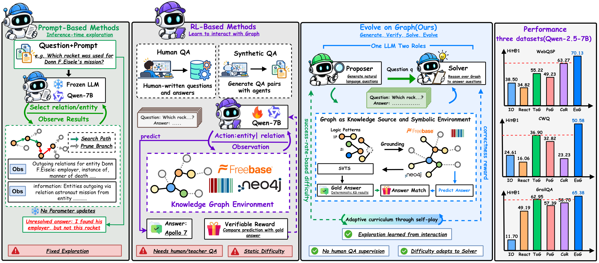
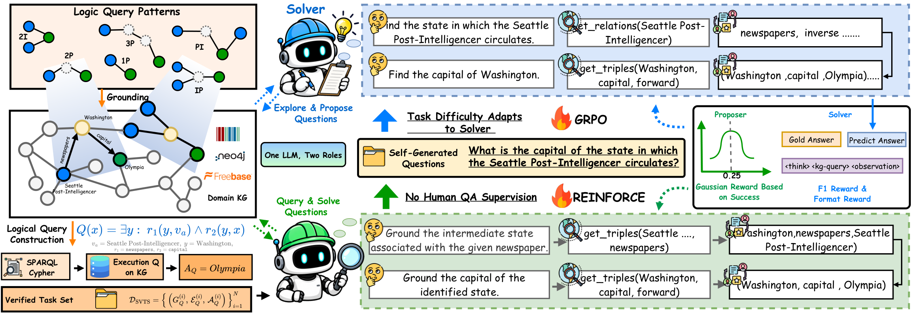

<div align="center">

<h1> Evolve on Graph</h1>

### 无需问题标注的自进化知识图谱推理

[](https://arxiv.org/abs/2610.35598)
[](https://szy5.github.io/EoG/)
[](https://huggingface.co/Bobzong/EoG)

[English](README.md) | **简体中文**

</div>

---

## 🔥 News
[2026-10-27] 📄 EoG 论文已发布在 [arXiv](https://arxiv.org/abs/2610.35598)。

---

金融、工业等真实领域中的知识图谱（KG）大多没有问答（QA）标注。**Evolve on Graph（EoG）** 让大语言模型在这样的 KG 上**无需任何 QA 标注**即可提升多跳推理能力。同一个 LLM 在图上自博弈扮演两个角色：**Proposer** 负责出题，**Solver** 通过多轮图探索作答。训练任务、标准答案和难度信号全部来自图本身。

## 🧭 知识图谱推理范式

<p align="center">
  
</p>

- **基于提示的智能体**（如 ToG、PoG）用冻结的 LLM 探索图。它们不需要标注，但探索策略由提示词固定，无法通过交互提升。
- **基于强化学习的智能体**（如 KG-R1、GraphWalker）用强化学习学习探索，但训练数据是人工编写或闭源模型合成的固定 QA，拓扑分布在训练前就已确定。
- **EoG** 在 KG 上自己出题、自己解题：答案来自在图上执行查询，任务难度跟随 Solver 变化。使用 Qwen2.5-7B-Instruct 时，EoG 在三个 Freebase 基准上超过图中所有基线。

## 🧠 方法

<p align="center">
  
</p>

EoG 由三部分组成：

- **Graph Self-Play（图自博弈）。** Proposer 读取一个推理骨架，其中只有锚点实体是真实名称（中间实体和答案实体用 `Mid1@` / `Ans@` 等占位符表示）。它从锚点出发，用 `get_relations` / `get_triples` 探索图，然后写出一个自然语言问题。Solver 在同一张图上探索作答，用 GRPO 训练，奖励为答案 F1 加格式分。
- **Symbolically Verifiable Topology Synthesis（SVTS，符号可验证拓扑合成）。** 将六种查询模式（`1p`、`2p`、`3p`、`2i`、`ip`、`pi`）落地到真实事实上，编译成可执行查询并在 KG 上运行，得到每个任务完整的标准答案集合。
- **Boundary-Aware Graph Curriculum（能力边界感知的图课程）。** Proposer 用 REINFORCE 训练，奖励是 Solver 得分方差上的高斯函数，在方差为 1/4 时取最大值，此时 Solver 的 GRPO 学习信号最强。

## 🏆 主要结果

五个公开 KGQA 基准上的 Hit@1 / F1（%）。除 EoG 外都是无标注基线，其中 Graph Reranker 的平均表现最强。包含提示类、智能体类和全监督基线的完整结果见论文。

| 方法 | LLM | WebQSP | CWQ | GrailQA | GTSQA | WikiWebQuestions | 平均 |
| --- | --- | ---: | ---: | ---: | ---: | ---: | ---: |
| Graph Reranker | Qwen2.5-7B | 68.27 / 48.89 | 37.69 / 33.28 | 56.28 / 48.99 | 37.85 / 36.65 | 70.37 / 53.48 | 54.09 / 44.26 |
| EoG | Qwen2.5-3B | 63.57 / 55.22 | 38.14 / 36.84 | 56.17 / 55.05 | 30.95 / 28.76 | 41.26 / 34.30 | 46.02 / 42.03 |
| **EoG** | **Qwen2.5-7B** | 70.13 / **62.10** | **50.58 / 49.27** | **65.38 / 63.01** | **48.39 / 46.36** | **73.28** / 60.82 | **61.55 / 56.31** |
| EoG | Llama-3.1-8B | **71.82** / 61.51 | 50.36 / 48.25 | 63.87 / 62.59 | 36.37 / 34.67 | 70.53 / **62.55** | 58.59 / 53.91 |

使用 Qwen2.5-7B-Instruct 时，EoG 的平均 Hit@1 比最强的无标注基线高 **7.46**。在 IndustryCarBench（基于工业 KG、没有训练集的 500 题基准）上，EoG 比最强基线 ToG 高 **17.80 Hit@1**。

## ⚙️ 环境配置

### 依赖

- Linux 与 NVIDIA GPU。
- 带 CUDA 的 PyTorch（参考环境为 Python 3.13、CUDA 12.8、PyTorch 2.9）。
- 一个 Freebase SPARQL 端点（见 [Freebase](#freebase)）。

### Python 环境

```bash
git clone https://github.com/Szy5/EoG.git
cd EoG

python -m venv .venv
source .venv/bin/activate
python -m pip install --upgrade pip

# 先安装与你的 CUDA 版本匹配的 PyTorch。
pip install --extra-index-url https://download.pytorch.org/whl/cu128 \
  "torch==2.9.*" torchvision torchaudio

pip install -r training/requirements.txt
```

训练框架（veRL + SGLang 多轮 rollout）沿用 [Search Self-Play (SSP)](https://github.com/Alibaba-Quark/SSP)。

### Freebase

按 [ChatKBQA](https://github.com/LHRLAB/ChatKBQA) 的说明用 Freebase dump 搭建 Virtuoso 并启动 SPARQL 服务。检查端点是否可用：

```bash
python scripts/check_freebase_endpoint.py \
  --endpoint http://127.0.0.1:3001/sparql \
  --query 'SELECT ?p ?o WHERE { <http://rdf.freebase.com/ns/m.0hqs1x_> ?p ?o . } LIMIT 1' \
  --require-bindings
```

### 检查安装

以下测试只需 CPU，不需要 GPU 或 KG：

```bash
PYTHONPATH=.:training:training/verl python -m pytest \
  tests/kg_ssp/unit/test_data_contract.py \
  tests/kg_ssp/unit/test_webqsp_cwq_val_convert.py \
  tests/kg_platform/test_config_cli.py
```

## ⚡ 快速开始（Freebase）

### 1. 获取 SVTS 任务

请将 Freebase 任务放在 `data/svts/freebase_tasks.jsonl`。每行是一个任务，即一个落地后的查询图及其执行得到的答案集合，不包含自然语言问题：

```json
{"qid": 600001000161, "task_id": "iso-1_00161", "template_id": "Iso-1",
 "question_entity": [{"name": "Jenna Dewan", "id": "m.0ck1l0"}],
 "answer_entity": [{"name": "London", "id": "m.04jpl"}],
 "path": ["Jenna Dewan --people.person.children--> Mid1@ --location.location.people_born_here--> Ans@"],
 "triples": [["Jenna Dewan", "people.person.children", "entity_1"],
             ["entity_1", "location.location.people_born_here", "Ans"]],
 "num_edge": 2, "domains": "people",
 "sparql_query": "PREFIX ns: <http://rdf.freebase.com/ns/> SELECT DISTINCT ?ans WHERE { ... }"}
```

### 2. 构建 Proposer 种子数据

```bash
INPUT_JSONL=data/svts/freebase_tasks.jsonl \
OUTPUT_DIR=data/train \
  bash scripts/prepare_kgqa_data.sh
```

输出为 `data/train/svts_freebase.{jsonl,parquet}`，其中 `data_source=kgqa_svts_freebase`。它们就是 `GENERATION_DATA_PATH` 和 `TRAIN_PARQUET` 的默认值。

### 3. 构建验证集

验证时只用 Solver 回答 WebQSP / CWQ 的测试问题。将原始测试文件转换为 Solver 格式的 Parquet：

```bash
KGQA_SPARQL_ENDPOINT=http://127.0.0.1:3001/sparql \
python training/examples/data_preprocess/webqsp_cwq_val/convert.py \
  --webqsp-path data/raw_datasets/WebQSP.test.json \
  --cwq-path data/raw_datasets/ComplexWebQuestions_test.question_entities.jsonl \
  --webqsp-output-parquet data/val/val_webqsp.parquet \
  --cwq-output-parquet data/val/val_cwq.parquet
```

`data/val/val_webqsp.parquet` 是 `VAL_PARQUET` 的默认值。

### 4. 检查解析后的配置

```bash
KGQA_CONFIG_ONLY=1 \
FREEBASE_SPARQL_ENDPOINT=http://127.0.0.1:3001/sparql \
MODEL_PATH=/path/to/Qwen2.5-7B-Instruct \
  bash scripts/platforms/local.sh
```

如果改用 `KGQA_PREFLIGHT_ONLY=1`，启动脚本还会检查所有输入文件、探测端点并生成 KG profile，然后在启动 Ray 之前退出。

### 5. 训练

**单机**（无需 Slurm，使用当前 Python 环境、你已启动的 Freebase 端点和校验服务）：

```bash
FREEBASE_SPARQL_ENDPOINT=http://127.0.0.1:3001/sparql \
JUDGE_BASE_URL=http://<verifier_host>:5000/v1 \
MODEL_PATH=/path/to/Qwen2.5-7B-Instruct \
KGQA_EXPERIMENT_CONFIG="$PWD/scripts/experiments/baseline.env" \
  bash scripts/platforms/local.sh
```

GPU 数量由 `nvidia-smi` 自动检测（可用 `NUM_GPUS_PER_NODE` 覆盖）。Rollout 张量并行默认 `ROLLOUT_TP=4`。

输出（checkpoint、rollout、验证结果、TensorBoard 日志和运行摘要）位于 `OUTPUT_ROOT/<run_id>/`。全部实验变量见 [`scripts/experiments/README.md`](scripts/experiments/README.md)。其他基座模型和 KG 使用该目录下的其他配置文件，例如 `baseline_model_llama31_8b_instruct.env` 或 `gtsqa_v9.env`（Wikidata，不需要 Freebase）。

## 🎯 评测

**Freebase 基准（WebQSP、CWQ、GrailQA）。** 以仅验证模式运行某个 checkpoint 的 Solver：

```bash
VAL_BEFORE_TRAIN=True VAL_ONLY=True PROPOSER_RAG_FILTER=False \
MODEL_PATH=/path/to/run/ckpt/global_step_N/actor/huggingface \
VAL_PARQUET=data/val/val_cwq.parquet \
FREEBASE_SPARQL_ENDPOINT=http://127.0.0.1:3001/sparql \
  bash scripts/platforms/local.sh
```

WebQSP 和 CWQ 的 Parquet 来自第 3 步。逐题预测写入 `OUTPUT_ROOT/<run_id>/val/`，Hit@1 / F1 输出到终端和 TensorBoard。

## 🏗️ 仓库结构

```text
EoG/
├── configs/                  # KG profile 与评测数据集绑定
├── docs/                     # 项目主页
├── kg_platform/              # 统一的 KG 后端（Freebase SPARQL、Wikidata/汽车 KG mmap）与工具
├── scripts/
│   ├── platforms/            # 入口脚本：local.sh、roihu_sbatch.sh 等
│   ├── experiments/          # 实验 .env 配置
│   ├── train_eog.sh          # 共用训练运行时
│   └── prepare_kgqa_data.sh  # SVTS 任务 -> Proposer 种子数据
├── training/
│   ├── quarl/                # 自博弈训练器、奖励、工具与提示词
│   └── verl/                 # 内置的 veRL
└── tests/
```

## 🙏 致谢

EoG 基于 [veRL](https://github.com/volcengine/verl)、[SGLang](https://github.com/sgl-project/sglang)、[Search Self-Play](https://github.com/Alibaba-Quark/SSP)和 [ChatKBQA](https://github.com/LHRLAB/ChatKBQA)（Freebase 搭建）构建，感谢这些项目的作者。

## 📚 引用

```bibtex
@article{sun2026evolve,
  title   = {Evolve on Graph: Self-Evolving Knowledge Graph Reasoning without Question Annotations},
  author  = {Sun, Zongyuan and Zhao, Shuai and Shu, Ke and Zhu, Ziyue and Wu, Shangyang and Lin, Yuanlin and Wang, Tao and Li, Shiyue and Du, Yingjun and Luu, Anh Tuan and Luo, Haoran},
  journal = {arXiv preprint arXiv:2610.35598},
  year    = {2026}
}
```

## 📄 许可证

项目许可证将在正式公开前添加。`training/verl/` 下的内置组件保留其原有许可证。
